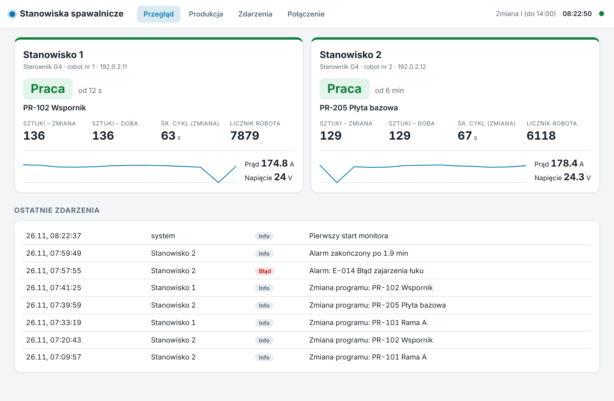

# Weld Cell Monitor

> **Status: prototyp — działa w pełni na symulatorze; warstwa OPC UA jest napisana, ale NIEPRZETESTOWANA na prawdziwym sterowniku.**
> Projekt nieoficjalny, niezwiązany z producentem robotów ani z żadnym pracodawcą; nie zawiera danych firmowych.
> English summary at the bottom.

Panel w przeglądarce do monitorowania i rozliczania produkcji z dwóch zrobotyzowanych stanowisk spawalniczych
(sterowniki serii G4, komunikacja OPC UA). Powstał jako lekka alternatywa dla drogiego, komercyjnego systemu do zbierania danych z robotów.



*Zrzut: tryb symulacji, dane wymyślone.*

## Co potrafi

- **Przegląd na żywo**: stan stanowiska (praca / postój / alarm / brak połączenia), program, sztuki na zmianę i dobę, średni cykl, prąd i napięcie.
- **Rozliczenie produkcji** na zmiany lub doby (konfigurowalne zmiany, strefa czasowa, poprawna obsługa zmiany czasu): sztuki, czas pracy/postoju/alarmu/braku danych, wykorzystanie, eksport CSV pod polskiego Excela.
- **Dziennik zdarzeń** bez kasowania danych: alarmy, zmiany programu, utrata i powrót łączności, restarty monitora; filtry i eksport CSV.
- **Uczciwa księgowość luk**: czas, gdy monitor był wyłączony, jest oznaczany jako „brak danych”, a nie zgadywany; produkcja liczona z przyrostu licznika robota, a nieprawdopodobne skoki licznika są pomijane i zapisywane jako zdarzenie.
- **Checklista uruchomienia OPC UA** i narzędzia diagnostyczne (`tools/check_robot.py`, `tools/browse_nodes.py`), które pomagają znaleźć węzły, bo dokumentacja producenta nie podaje listy zmiennych.

## Szybki start (symulator)

```bash
python -m venv .venv && source .venv/bin/activate      # Windows: .venv\Scripts\activate
pip install -r requirements.txt
python -m monitor                                      # http://127.0.0.1:8080
```

Bez `config.json` używany jest `config.example.json` (adresy z zakresu dokumentacyjnego 192.0.2.x). Własną konfigurację zapisz jako `config.json` (jest w `.gitignore`).
Testy: `pip install -r requirements-dev.txt && pytest`.

## Konfiguracja i bezpieczeństwo

| Ustawienie | Gdzie | Uwagi |
|---|---|---|
| Adres nasłuchu | `config.json` → `host` | domyślnie `127.0.0.1`; `0.0.0.0` tylko z logowaniem |
| Logowanie do panelu | `MONITOR_USER`, `MONITOR_PASSWORD` | HTTP Basic; bez nich program ostrzega przy nasłuchu w sieci |
| Hasło do robota | `ROBOT_R1_PASSWORD`, `ROBOT_R2_PASSWORD` | nigdy w pliku konfiguracyjnym; ostrzeżenie przy haśle pustym/fabrycznym |
| Zmiany, strefa czasowa | `config.json` | `shifts`, `timezone` |

Panel wysyła nagłówki CSP/nosniff/X-Frame-Options, zapisy wymagają JSON i zgodnego `Origin`, a `/api/config` nie ujawnia haseł ani ścieżek do kluczy.
Szczegóły i zgłaszanie podatności: [SECURITY.md](SECURITY.md).

## Przejście na prawdziwe roboty

1. Wykonaj checklistę z zakładki „Połączenie” (IP, certyfikaty, tryb automatyczny) dla obu robotów.
2. `pip install asyncua cryptography`, wstaw certyfikaty do `certs/`, ustaw adresy IP w `config.json`, hasła w zmiennych środowiskowych.
3. `python tools/check_robot.py --make-cert`, potem `python tools/check_robot.py R1` (test połączenia etapami). `python tools/browse_nodes.py R1` zapisze drzewo węzłów (alternatywa: UaExpert).
4. Wpisz znalezione `node_id` do `nodes.json` (w `state_map` przypisz wartości stanu do `work` / `idle` / `alarm`).
5. `python -m monitor --mode opcua`. Pierwsze testy tylko do odczytu.

### Czego jeszcze nie wiem (i nie udaję, że wiem)

1. Lista zmiennych OPC UA robota: w `nodes.json` wszystkie `node_id` są puste, bez nich tryb `opcua` nic nie pokaże.
2. Numer portu (4840 to domyślny port OPC UA, nie wartość z dokumentacji) i dokładne ustawienia Security Policy (w configu jest założenie).
3. Czy robot zaakceptuje certyfikat klienta wygenerowany własnym narzędziem (instrukcja zakłada certyfikaty z oprogramowania producenta).

Symulator wymyśla stany, programy, licznik i alarmy; jego dane nie odzwierciedlają tego, co zwróci prawdziwy sterownik.

## Znane ograniczenia

- Warstwa OPC UA (`sources.OpcUaSource`, narzędzia w `tools/`) nie była uruchomiona na sprzęcie ani na serwerze testowym, więc nie ma jej w testach.
- Sztuki zrobione, gdy monitor był wyłączony, nie zostaną dopisane (przerwa jest oznaczona).
- HTTP Basic bez TLS nie chroni hasła w sieci; za proxy z TLS albo wyłącznie w zaufanej sieci. Brak ról i logu audytowego.
- SQLite i jeden proces zbierający dane; przewidziane na kilka przeglądarek i kilka stanowisk.
- Wbudowany serwer Flask jest tylko awaryjny; z zainstalowanym `waitress` działa stabilniej.

## English summary

A browser dashboard that tracks and reports production for two robotic welding cells (G4 controllers over OPC UA).
It runs fully on a built-in simulator; the OPC UA layer is written but **untested against real hardware** and needs node IDs that
the vendor manual does not list (helper tools included). Includes shift/day production reports (DST-aware), a non-destructive event log,
CSV export with formula-injection protection, optional Basic auth, env-based secrets and a pytest suite.
Unofficial; not affiliated with the robot vendor or any employer; contains no company data.

## Licencja

MIT — zob. [LICENSE](LICENSE).
